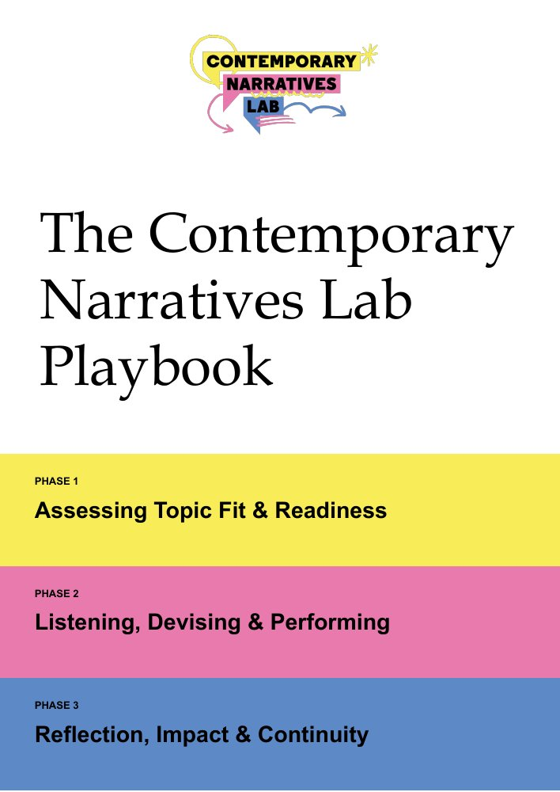

The Contemporary Narratives Lab Playbook is out. It is a practical guide for journalists, artists and community organisations who want to make live, performed journalism with the communities their stories are about. We're launching it at the [International Live Journalism Festival](https://www.headliner.eu/ljf26) in Berlin, 18–20 November 2026.

<!--more-->

**[Download the Playbook and its companion workbook from Zenodo](https://doi.org/10.5281/zenodo.24115695)** (free to download, share and adapt with credit, under CC BY 4.0).

The Contemporary Narratives Lab brings artists, journalists, researchers and communities together to turn reporting on contentious social issues into live, performed work. Since our first project in 2018, we have found that this kind of work can break down complex issues, reach people who might not read traditional journalism, and open space for civic discussion.

The Playbook draws on two of our projects: [HOME/CARE](/projects/home-care/) (2021), made with the Bureau of Investigative Journalism and the theatre company Coney about home care during the pandemic, and [It's Criminal](/projects/its-criminal/) (2023), made with The Ferret and residents of Govanhill in Glasgow about how crime reporting affects communities. It also draws on feedback from a June 2026 roundtable of journalists, artists, community participants and academics.

It follows a project through three phases: deciding whether it should happen at all; listening, devising and performing the work with the community; and reflecting on its impact and what carries on afterwards. Along the way, it takes up practical questions such work raises: who owns the finished work, how to keep participants emotionally safe, what the project will really cost, and how to show its impact. It answers them with worked examples and two real project budgets.

It is not a recipe: readers can take the phase they are in and leave what doesn't apply.

The companion workbook has twelve fill-in sheets, starting with a community map.

## Credits

Written by Glenda Cooper, Robin Kwong and André Piza. Creative lead: Vishnu Raviprasad.

With thanks to Anne Flynn, Vicky Gayle, Rachel Hamada, Rhianna Ilube, Emma Jacobs, Josephine Machon and Miriam Wells, and to everyone who took part in HOME/CARE, It's Criminal and our roundtable.

## How to cite

Cooper, G., Kwong, R., Piza, A. and Raviprasad, V. (2026). *The Contemporary Narratives Lab Playbook*. Zenodo. [https://doi.org/10.5281/zenodo.24115695](https://doi.org/10.5281/zenodo.24115695)
